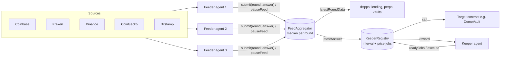

# PotFeeds + PotKeeper

**An agent-operated oracle and keeper network for Portaldot V3.**

Portaldot V3 mainnet went live on Oct 24, 2026, and its built-in oracle module is still empty. There's no automation layer either. Without price data and keepers, nobody can safely build lending, perps, stablecoins, vaults or stop-losses on Portaldot.

PotFeeds fills both gaps with autonomous AI agents:

- **Feeder agents** pull prices from 5 public exchanges, drop outliers, decide on their own when to publish (deviation or heartbeat), and **circuit-break a feed** when sources disagree. An optional LLM risk reviewer can veto suspicious updates and explain why.
- **FeedAggregator** (Solidity, pallet-revive EVM) takes each agent's answer per round and finalizes at the **median** once quorum is reached. It exposes a Chainlink-style `latestRoundData`, so dApps integrate in minutes.
- **Keeper agents** watch **KeeperRegistry** jobs (time-interval or price-triggered), simulate first, then execute and get paid in tPOT/POT from the job's balance.

Built for Portaldot Hacker House 2026 (tracks: Node Operations & Tooling / Modular Cloud & Middleware). Mainnet is the goal, not the hackathon.

## Architecture



More detail: [docs/ARCHITECTURE.md](docs/ARCHITECTURE.md).

## Quick start

```bash
npm install
npm test                  # 11 contract tests on the local Hardhat chain
cp .env.example .env      # add a fresh, testnet-only DEPLOYER_KEY
npm run deploy:testnet    # writes deployments/portaldotTestnet.json
npm run feeder            # start a feeder agent (add --once for one pass)
npm run keeper            # start a keeper agent
npm run status            # print feeds, rounds and jobs
npm run demo:local        # local end-to-end loop on a throwaway Hardhat node
```

## Local end-to-end demo

`npm run demo:local` boots a throwaway Hardhat node on port 18545, deploys all
three contracts, registers a `PriceBelow` job on DemoVault at 0.1% *above* live
BTC, then runs one feeder pass and one keeper pass. No testnet funds or `.env`
needed. It prints the full loop as it happens:

```
[3/6] live BTC mid=77157.40 (sources: coinbase, kraken, binance, coingecko, bitstamp), threshold=7723455740000 (0.1% above)
[4/6] [feeder] BTC / USD submit: first round {"mid":77157.4,...}
[4/6] [feeder] BTC / USD submitted round 1 {"answer":"7715740000000",...}
       round 1 finalized: answer=77157.4 USD (median), finalized=true
[5/6] [keeper] executed job 0 {"target":"0x0165...","reward":"500000000000000000",...}
       keeper balance 10000.0 -> 10000.4998... ETH (reward received)
       DemoVault: protectedMode=true, triggeredAt=7715740000000 (77157.4 USD)
```

Details: the feeder uses the real `agent/src/sources.ts` exchange gathers and
`agent/src/brain.ts` policy to decide; the keeper simulates each job
(`staticCall`) before executing. The job is `oneShot`, so it fires exactly once
and the vault ends in `protectedMode`.

## Portaldot V3 testnet

| Item | Value |
|---|---|
| EVM RPC | https://test-evm-rpc-v3.portaldot.dev |
| Chain ID | 420420777 |
| Substrate WSS | wss://test-node-v3.portaldot.dev |
| Explorer | https://scanner-testnet-v3.portaldot.dev/ |
| Native token | tPOT, 14 decimals |

To fund a MetaMask (EVM) account from a SubWallet (native) account, run `node scripts/evm-to-ss58.js 0xYourEvmAddress` and send tPOT to the printed `5...` address.

## Deployed contracts (testnet)

_Filled after the first deploy, from `deployments/portaldotTestnet.json`._

| Contract | Address | Deploy tx |
|---|---|---|
| FeedAggregator | - | - |
| KeeperRegistry | - | - |
| DemoVault | - | - |

## Roadmap to mainnet

1. Testnet: 3 independent feeder agents, quorum 3, BTC/ETH/DOT feeds, live keeper demo.
2. Feeder bonding + slashing for answers far from the median; keeper rewards from job fees.
3. Native adapter: also write finalized rounds into Portaldot's built-in oracle pallet (pending feeder-permission answer from the core team) and an ink! port.
4. POT/USD feed once POT trades on enough venues.
5. Mainnet deploy as soon as a public V3 EVM RPC is published.

## License
MIT
